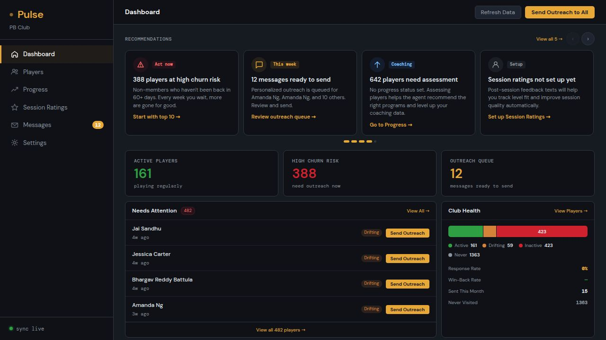
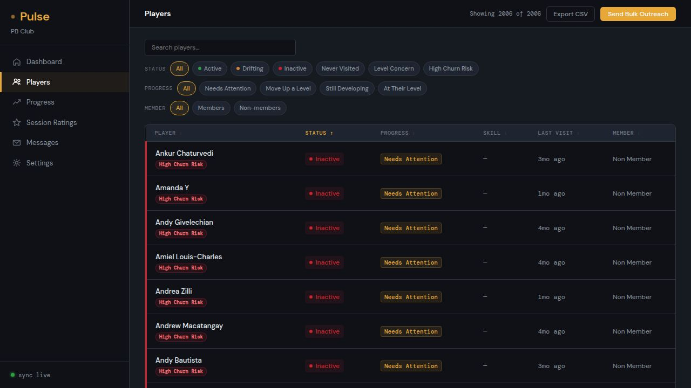
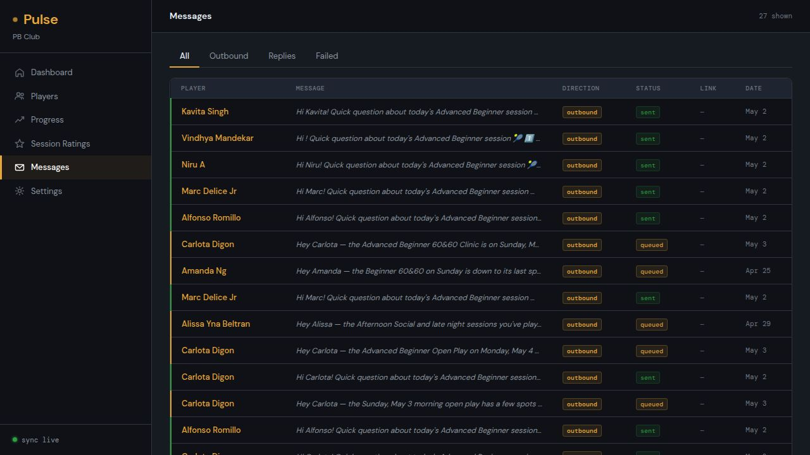
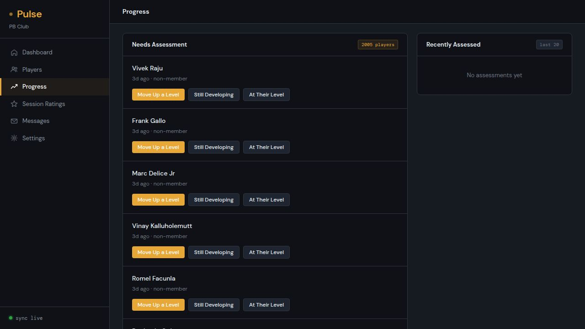
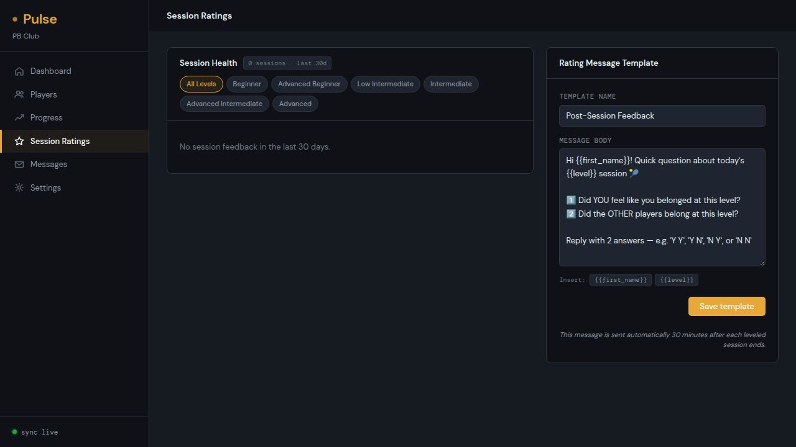
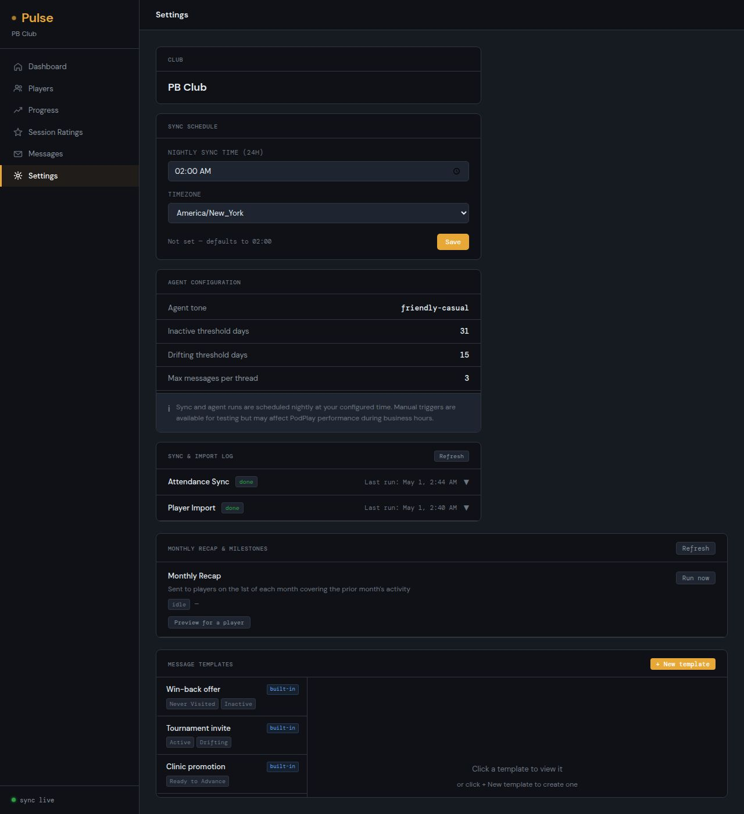

# Pulse — Your Club Retention Guide

> A plain-English guide for club owners and coaches

---

## Welcome to Pulse

Running a pickleball club means knowing your players — who's improving, who's drifting away, and who just needs a friendly nudge to come back. But when you have hundreds of members, it's impossible to keep track of everyone by memory alone.

Pulse is a retention tool built specifically for pickleball clubs. It connects to your booking platform, learns who your players are, and helps you reach out to the ones who are at risk of not coming back. It writes personalized text messages for you, lets you review and edit them before anything is sent, and tracks whether they worked.

Think of Pulse as a very attentive assistant who has read every player's attendance history and is ready to suggest the right message at the right time — while you stay in charge of every send.

Nothing ever goes out without your approval. Pulse prepares; you decide.

---

## How Pulse Works — The Big Picture

Here's the whole system in plain English:

```
1. SYNC
   Pulse connects to your booking platform (PodPlay)
   and pulls in your player list every night.
         ↓
2. SCORE
   It looks at each player's visit history, social
   connections, and membership status to figure out
   who might be fading away.
         ↓
3. GENERATE
   For at-risk players, Pulse uses AI to write a
   personal outreach message — referencing their
   history, their court friends, and upcoming sessions.
         ↓
4. YOU REVIEW
   The Outreach Queue shows you every message waiting
   to be sent. Edit them, dismiss ones you don't like,
   send the ones you do.
         ↓
5. TRACK
   Pulse records every send, reply, and return visit
   so you can see what's working over time.
```

Player data refreshes automatically every night. You can also trigger a manual refresh from the dashboard any time you want.

---

## Your Dashboard



This is your home base. Everything important is visible from here.

### Recommendation Tiles

The row of cards at the top are your action items for today. Pulse scans your player data and surfaces the things that need your attention most.

Each tile has a colored label telling you the urgency:

- **Act now** (red) — something needs your attention today. Usually high-churn players who haven't been back in 60+ days.
- **This week** (amber) — outreach messages are queued and ready. You should review and send them.
- **Coaching** (blue) — players haven't been assessed yet. The more assessments you record, the smarter Pulse gets.
- **Setup** (grey) — a feature isn't configured yet, like Session Ratings.

Click any tile to jump directly to the relevant page. Tiles disappear once you've taken action, and you can dismiss ones you're not ready to act on.

### The Three Stat Cards

The three big numbers below the tiles give you a snapshot of club health:

| Card | What it means |
|---|---|
| **Active Players** | Players who have visited in the last 2 weeks — your core regulars |
| **High Churn Risk** | Players showing warning signs: they used to come regularly, now they're fading |
| **Outreach Queue** | Messages that are written and waiting for you to review and send |

### Needs Attention Panel

On the left side of the main grid, you'll see players who need a personal outreach message. These are your drifting and inactive players — people who were regulars but haven't been back recently.

For each player you'll see:
- Their name
- How long ago they last visited
- Their status badge (Drifting or Inactive)
- A **Send Outreach** button that generates a personalized message for them on the spot

Click **View All** to see the full list on the Players page.

### Club Health Panel

On the right side, the Club Health bar chart shows where all your players stand at a glance:

- **Green** — Active (playing regularly)
- **Orange** — Drifting (2+ weeks without a visit)
- **Red** — Inactive (30+ days, at risk of not coming back)
- **Grey** — Never Visited (signed up but haven't shown up yet)

Below the bar, you'll see your **Response Rate** (what percentage of players reply to your messages), **Win-Back Rate** (players who returned after a message), and how many messages you've sent this month.

### Outreach Queue Panel

This panel shows the first few messages waiting to be sent. For each one you can:

- **Send** — delivers the message via text immediately
- **Edit** — opens the message text so you can tweak the wording
- **Dismiss** — removes it from the queue without sending

If a player was contacted in the last 24 hours, the Send button will be greyed out with a cooldown timer. This prevents players from getting multiple texts in a day.

### New Player Intros Panel

This panel shows players who have only visited once or twice and have upcoming sessions booked. It also shows who they already know at the club.

Before each session, glance at this panel and plan a quick introduction. Connecting a new player with a familiar face is one of the most effective things you can do to get them to come back.

---

### What to Do Every Morning (5-Minute Routine)

1. **Check the recommendation tiles.** Anything marked "Act now" should be addressed today.
2. **Review the Outreach Queue.** Send 2–3 messages. Edit any that don't feel quite right.
3. **Glance at New Player Intros.** Note any first- or second-timers in today's sessions and plan a quick welcome.
4. **Check Needs Attention.** See if anyone stands out for a personal follow-up.

---

## Your Players



The Players page is your full member roster. Every player Pulse knows about is here.

### How to Find a Specific Player

Type any part of a player's name into the search bar at the top. The list filters as you type.

### Understanding Player Status

Every player has a status based on when they last visited:

| Status | What it means |
|---|---|
| **Active** | Visited in the last 2 weeks — a regular |
| **Drifting** | Hasn't been back in 2–4 weeks — worth a check-in |
| **Inactive** | Hasn't visited in 30+ days — at real risk of not returning |
| **Never Visited** | Signed up through the booking platform but never showed up |

### Understanding Churn Risk

Some players show a **High Churn Risk** or **Medium Risk** badge. This means Pulse has detected patterns that match players who typically stop coming back — things like a big drop in visit frequency, no close connections at the club, or not responding to previous outreach.

**High Churn Risk** means the window to re-engage is closing. Act within 48 hours if you can.

**Medium Risk** means there are early warning signs — worth keeping an eye on and sending a friendly message soon.

Players with a **Low** score don't show a badge — they're doing fine.

### Understanding Player Progress

The Progress column shows what you've recorded about a player's skill development:

| Badge | What it means |
|---|---|
| **Needs Attention** | You haven't assessed this player yet |
| **Move Up a Level** | They're ready for more challenging sessions |
| **Still Developing** | Working on it — keep them where they are |
| **At Their Level** | Playing right where they belong |

Filling in progress for your players makes Pulse smarter. The AI uses this when recommending sessions and writing outreach messages.

### Filtering and Searching

Use the filter chips below the search bar to narrow the list:

**STATUS** — Show only Active, Drifting, Inactive, or Never Visited players. You can also filter by **Level Concern** (players who've told Pulse they feel out of place at their level) or **High Churn Risk**.

**PROGRESS** — Filter by assessment status. Use "Needs Attention" to find everyone you haven't assessed yet.

**MEMBER** — Separate members from non-members.

Click any column header to sort. The table remembers your sort while you're on the page.

### Sending Outreach to a Specific Player

You can send a message to any player directly from the Players page:

1. Click a player's name to open their player card
2. Click **Run Agent** to generate a personalized message for them
3. The message will appear in the Outreach Queue on the dashboard

Or use **Send Bulk Outreach** in the top-right corner to send a template message to every player matching your current filter.

---

## The Player Card

Clicking any player's name opens their full profile in a panel on the right side of the screen. Here's what each section shows:

- **Status and churn risk** — engagement state and risk level at a glance
- **Progression** — buttons to mark their progress (Move Up, Still Developing, At Their Level)
- **Coach level** — where you can override their assigned skill level if you know better than what the system calculated
- **Level confidence** — a bar chart showing how confident the system is about each level they've played at, based on session feedback and attendance
- **DUPR rating** — if you know their official DUPR rating, enter it here to improve level recommendations
- **Attendance history** — every session they've attended, in order
- **Notes** — freeform space for anything you want to remember about this player
- **Message history** — every message Pulse has sent them and any replies

---

## Outreach & Messages



The Messages page is a log of every text message that's been sent or is waiting to be sent.

### How Messages Are Generated

When you click "Send Outreach" on the dashboard, or when the nightly run creates new messages, Pulse uses AI to write a personalized text for each player. It looks at:

- How long it's been since they visited
- Which of their club friends have upcoming sessions booked
- Their skill level and recent progress
- What programs are available that match their level

The result is a message that sounds like it came from a coach who knows them — not a marketing blast. But it's still just a draft. You're in charge of what actually gets sent.

### Reviewing a Message Before Sending

From the Dashboard's Outreach Queue, each pending message shows the player's name, a preview of the message text, and their status badge.

If the player was reached out to recently, a cooldown label will appear (e.g. "4h 30m cooldown"). The Send button will be disabled until the cooldown clears.

### Editing a Message

1. In the Outreach Queue on the Dashboard, click **Edit** next to any message
2. The message text becomes editable — change anything you like
3. Click **Save** to keep your changes, or **Cancel** to go back to the original

You know your players better than any AI does. Edit freely.

### Dismissing a Message

Click **Dismiss** to remove a message from the queue without sending it. This is the right move when the message isn't a good fit right now, or if you'd rather reach out to this player personally.

Dismissing a message doesn't affect the player's record — you can always generate a new message for them later.

### Understanding Message Status

In the Messages page, each row shows a status badge:

| Status | What it means |
|---|---|
| **queued** | Written and waiting for you to send |
| **sent** | Delivered to the player's phone |
| **delivered** | Confirmed delivered by the carrier |
| **replied** | Player sent a message back |
| **skipped** | You dismissed it |
| **failed** | Something went wrong with delivery |

### What Happens After You Send

Once you send a message, Pulse:

1. Records the send and updates the player's "last contacted" time
2. Starts a 24-hour cooldown — no more messages can be sent to that player until it expires
3. Watches for a reply. If the player responds, you'll see it in the Replies tab on the Messages page
4. Tracks whether the player returns and visits again after receiving the message — this feeds the Win-Back Rate stat on your dashboard

---

## Player Progress (Coaching Tool)



The Progress page is where you record your coaching observations — which players are ready to move up, which are still developing, and which have found their level.

### What Progress Assessment Means and Why It Matters

When you mark a player's progress, Pulse uses that information in two ways:

1. **Better outreach messages** — if Pulse knows a player is ready to move up, it can mention that in their message and recommend a more advanced session
2. **Smarter level placement** — it prevents Pulse from sending players to sessions where they won't fit

The more players you assess, the more accurate everything else becomes.

### How to Assess a Player

The "Needs Assessment" panel on the left shows every player who hasn't been assessed yet. For each one, you'll see their name, when they last visited, and their membership status.

Click one of the three buttons:

- **Move Up a Level** — they've outgrown their current level
- **Still Developing** — they're working on it, keep them where they are
- **At Their Level** — they're right where they belong

That's it. The assessment is saved immediately and the player moves to the "Recently Assessed" panel on the right.

### Assigning a Coach Level

For more precision, you can also set a specific level override from the player's card (click their name anywhere in Pulse to open it). Find the **Coach level** section and enter the level directly — like "3.0" or "Advanced Beginner."

Use this when you know a player's level doesn't match what the system calculated from their session history. Your coach assignment always takes priority.

### What Happens After You Assess

- The player's Progress badge updates everywhere in Pulse
- The AI incorporates the assessment into future outreach messages
- If you set a coach level, the level confidence bars in the player card update to reflect your knowledge

---

## Session Ratings



Session Ratings are short two-question texts sent to players automatically 30 minutes after a leveled session ends.

### What the Rating Text Looks Like

Players receive something like:

> Hi Sarah! Quick question about today's Intermediate session 🎾
> 1️⃣ Did YOU feel like you belonged at this level?
> 2️⃣ Did the OTHER players belong at this level?
> Reply with 2 answers — e.g. 'Y Y', 'Y N', 'N Y', or 'N N'

Players simply reply with two letters. The whole thing takes about 10 seconds.

### Why Session Ratings Matter

The answers help Pulse figure out whether each player is actually at the right level. If a player keeps saying "N" for themselves, that's a signal they might be struggling. If their court mates keep saying "N" about the group, there might be a level-placement issue worth reviewing.

This is what feeds the **Level Concern** filter on the Players page — players who consistently report feeling out of place.

### Reading the Session Health Panel

The Session Health panel on the left shows rating data for the last 30 days, broken down by level. Use the level tabs to focus on a specific group.

If you see a ⚠ **Review Needed** flag next to a level, it means the ratings for that level are consistently low — worth taking a look at whether the sessions are attracting the right mix of players.

### How to Edit the Rating Message Template

On the right side of the Session Ratings page, you can edit the exact text players receive.

The template supports two placeholders:
- `{{first_name}}` — fills in the player's first name
- `{{level}}` — fills in the session level (e.g. "Intermediate")

Click **Save template** when you're done. The new text will be used for all future sessions.

> Session Ratings require Twilio (text messaging) to be set up. If you're not sure whether it's active, check with whoever set up Pulse for your club.

---

## Monthly Recaps & Milestone Messages

These are two types of automatic celebration messages that Pulse can send on your behalf.

### Monthly Recaps

On the 1st of each month, Pulse sends a personal recap to players who attended at least 2 sessions in the previous month. The message covers:

- How many sessions they attended that month
- Their total session count at your club
- Who they played with most often
- Whether their level changed

Example: *"Hey Marcus! April was a great month — 6 sessions and you shared the court with Lisa T., David K., and Priya M. You're at 47 total sessions at PB Club. Keep the momentum going — see you out there!"*

These messages go into the Outreach Queue first, so you can review them before they're sent.

### Milestone Messages

Milestone messages celebrate big moments in a player's journey:

| Milestone | When it triggers |
|---|---|
| 10th session | Player hits their 10th visit — officially a regular |
| 25th session | A real committed player |
| 50th session | A major milestone worth celebrating |
| Best month ever | Player has their most active month yet (min. 3 sessions) |
| 3-week streak | Player has attended in 3 consecutive weeks |

Milestones are checked every night. Each milestone triggers only once (except the streak and best-month, which reset).

### How to Preview a Recap Before It Goes Out

1. Go to **Settings**
2. Find the **Monthly Recap & Milestones** section
3. Click **Preview for a player**
4. Enter the player's ID and click Generate

You'll see exactly what the message would say without anything being sent.

### How to Run Recaps Manually

In the same section of Settings, click **Run now** next to Monthly Recap. This generates recap messages for all eligible players immediately — useful if you want to send them at a different time than the 1st of the month.

---

## Settings



### Setting Your Sync Schedule

Under **Sync Schedule**, you can set what time each night Pulse updates your player data. The default is 2:00 AM.

You can also set your timezone so the schedule reflects your local time.

Click **Save** after making changes.

### Understanding the Agent Configuration

The Agent Configuration section shows the rules Pulse uses when categorizing players:

| Setting | What it does |
|---|---|
| **Drifting threshold days** | How many days without a visit before a player is flagged as "Drifting" (default: 15) |
| **Inactive threshold days** | How many days before they become "Inactive" (default: 31) |
| **Max messages per thread** | Maximum outreach messages to send to one player per conversation |
| **Agent tone** | The writing style of generated messages (default: friendly-casual) |

These are set when Pulse is configured for your club. Contact your setup team if you want them changed.

### Managing Message Templates

The **Message Templates** section lets you create and manage reusable message templates for bulk outreach.

Built-in templates (marked "built-in") can be viewed but not edited. You can create your own by clicking **+ New template**.

When creating a template, you can use these placeholders:
- `{{first_name}}` — replaced with the player's first name
- `{{skill_level}}` — replaced with their skill level
- `{{last_visit}}` — replaced with their last visit date
- `{{club_name}}` — replaced with your club's name

The Live Preview at the bottom shows exactly what the message will look like with real values filled in, and tells you how many SMS segments the message uses.

Tag each template with its intended use case (Active, Drifting, Inactive, etc.) so it's easy to find when sending bulk outreach.

### Reading the Sync & Import Log

The **Sync & Import Log** shows when Pulse last pulled data from your booking platform.

| Status | What it means |
|---|---|
| **done** | Last sync completed successfully |
| **running** | Sync is in progress right now |
| **error** | Something went wrong — check the log details |

Click the arrow (▼) next to any job to see the log lines and details. The most recent sync time is shown on the right.

If data seems stale, you can trigger a manual sync from the Dashboard using the **Refresh Data** button in the top-right corner.

---

## Frequently Asked Questions

**Why are so many players showing as Inactive?**

For newer clubs, this is normal. Many people sign up for a platform and try one session before drifting away. Players who joined in December or January and came once are a common example. The Inactive list is your opportunity — these are real people who showed up at least once and are worth trying to bring back.

---

**A player got a message but I didn't send it — why?**

Nothing sends without you clicking Send. Messages in the queue are drafts only. If you see a message has been sent that you didn't approve, check whether another staff member has access to Pulse and may have sent it.

---

**Can Pulse send messages automatically without my review?**

No. Every message requires a staff member to click Send. Pulse is a drafting and tracking tool — the decision to contact a player is always yours.

---

**How do I know if a message worked?**

Look at the **Win-Back Rate** on your Dashboard. This is the percentage of players who visited your club within 30 days of receiving an outreach message. You can also see individual message history in the player's card — click their name to open it.

---

**What is "Level Trust" and why does it matter?**

Level Trust (shown as confidence bars in the player card) is how sure Pulse is that a player belongs at a given skill level. It builds up over time from sessions attended, how players rate their own fit after sessions, and your coach-level assignments. Higher trust means better program recommendations. You can always override the system's view by setting a coach level directly.

---

**A player complained they got the wrong level recommendation — what do I do?**

Open their player card by clicking their name anywhere in Pulse, scroll to the **Coach level** section, and set their level directly. Your assignment overrides everything the system has calculated. It takes effect immediately.

---

**How often does Pulse update player data?**

Automatically every night at your scheduled sync time (default: 2:00 AM). You can also trigger a manual refresh any time using the **Refresh Data** button on the Dashboard.

---

**What does "Club Friends" mean?**

Pulse tracks which players tend to show up at the same sessions as each other. When two players have attended 3 or more sessions together, they become "court buddies." Pulse uses this when writing outreach messages — it can mention that a player's court friends have upcoming sessions they might enjoy, which makes the message feel more personal and gives the player a real reason to come back.

---

**Why does the Send button sometimes say "Xh Ym cooldown"?**

To avoid sending too many texts to the same person, Pulse enforces a 24-hour gap between messages to any player. If you sent a message to someone this morning, the Send button for their next message will be locked until tomorrow.

---

**What happens if a player texts back STOP?**

Pulse automatically marks them as opted out and cancels any pending messages for them. They won't receive any more texts until they text START to re-subscribe. This is handled automatically in the background.

---

## Tips for Getting the Most Out of Pulse

1. **Assess players early and often.** The Progress page shows every player who hasn't been assessed yet. Even a few assessments per week adds up fast, and each one makes the outreach smarter.

2. **Make the morning check a habit.** 5 minutes each morning — check tiles, send 2–3 messages, note any new players in today's sessions. The compounding effect over weeks is significant.

3. **Use the New Player Intros panel before sessions.** A first-time player who gets introduced to a regular is far more likely to return. This is the simplest, highest-impact thing you can do.

4. **Edit messages before sending.** The AI writes a strong first draft, but you know your players. A sentence that sounds like you — not a bot — makes a real difference.

5. **Act on High Churn Risk players within 48 hours.** The research on member retention is clear: the longer you wait after someone stops coming, the harder it is to bring them back. High Churn Risk is Pulse's way of saying the clock is ticking.

6. **Check Session Ratings weekly.** Once Twilio is live, the ratings build up quickly. Reviewing them weekly helps you spot if a particular level group is attracting the wrong mix of players before it becomes a problem.

7. **Don't worry about being perfect.** A message that's 80% right and actually sent is infinitely better than a perfect message that stays in the queue. Edit a little, send, and keep moving.

---

*Pulse is built to support your coaching — not replace it. You bring the relationships; Pulse handles the memory and the reach.*
